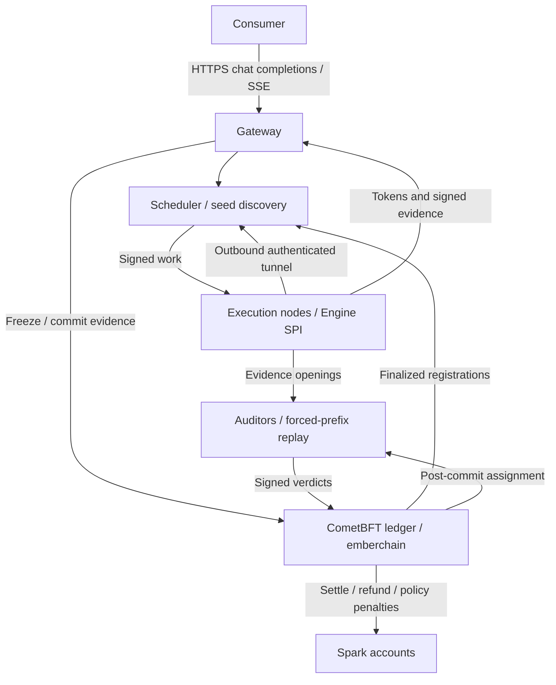

# Ember

Ember is an open, decentralized inference network. Its design is published as
part of this repository's documentation.

The public testnet is open for external testing. Testnet Spark is valueless
test credit: it is not money, is not sold, and carries over to no other network.
All validators currently run by a single operator. There is no third-party audit.
Privacy is Phase 0: relays see no plaintext; executing nodes and assigned auditors
can see plaintext. Do not send sensitive data.

## Disclaimer

Ember is experimental, open-source research software provided **as-is, without
warranty**, subject to the [Apache-2.0 license](LICENSE).

**Testnet Spark is valueless test credit.** It is not money or a financial
instrument and is not offered for sale. The Ember project operates no exchange
or fiat on/off-ramp of any kind.

Nothing in this documentation is an offer, solicitation, or investment advice.
Participation as an operator or consumer is at your own risk and subject to your
own local rules. Read the [full disclaimer](docs/DISCLAIMER.md) before participating.

## TL;DR

- Connect inference contributors through outbound tunnels, serve chat completions,
  audit signed execution evidence, and record Spark accounting on a shared ledger.
- Start with the [quickstart](docs/QUICKSTART.md) and [release verification](docs/SIGNING.md).

## What it is

- A **gateway** accepts OpenAI-compatible chat-completion requests and streams
  output; a scheduler selects eligible nodes, and seeds relay signed work.
- **Nodes** run a whole model or a shard stage, connecting outbound to a seed so
  they need no inbound public serving port.
- **Auditors** replay committed token prefixes and sign evidence-based verdicts.
- The **CometBFT ledger** (`emberchain`) orders accounts, stake, registrations,
  holds, evidence, audits, and settlement. Validators do not run model inference
  in consensus.
- The **Engine SPI** is the adapter contract between inference engines and the
  network's scheduling, signing, transport, and accounting.

## Why Ember

- **Concentrated supply:** inference is commonly accessed through a few clouds.
  Ember provides an open protocol and implementation for contributors to serve
  through gateways. Independent operators at public-network scale remain a target.
- **Idle, heterogeneous hardware:** devices cannot safely join merely by claiming
  capacity. Ember checks signed capabilities, model/Profile compatibility, stake,
  and registration before scheduling; eligible nodes can enroll through the public faucet.
- **Unverifiable remote execution:** a response alone says little about how it
  was produced. Signed commitments and sampled numerical replay make detected
  deviations attributable, with probabilistic rather than exhaustive guarantees.
- **Shared accounting:** open contributors need more than one gateway's private
  balance sheet. CometBFT records bounded holds, audits, and whole-model settlement;
  production issuance economics remain outside the delivered baseline.

## Use it

### Call a gateway

For a network you operate, set `EMBER_GATEWAY_URL` and `EMBER_TOKEN` to your
configured gateway and bearer token. Privacy Phase 0 protects relay transit; executing nodes and assigned auditors
can see plaintext. Do not send sensitive data.

```sh
curl -fsS "$EMBER_GATEWAY_URL/v1/chat/completions" \
  -H "Authorization: Bearer $EMBER_TOKEN" \
  -H 'Content-Type: application/json' \
  -d '{"model":"ember-model","messages":[{"role":"user","content":"Say OK"}],"max_tokens":2}'
```

### Run a node

Follow the [quickstart](docs/QUICKSTART.md) to verify v0.2.0 and install the node.
Model weights and network access parameters are supplied separately by your
network operator. The [network guide](docs/PUBLIC_NETWORK.md) describes the
configuration and trust requirements.

### Run a validator

On a separate validator host, verify and extract the release as above. From its
extracted directory, install into a fresh prefix and initialize a new home:

```sh
./install-release.sh --role validator --prefix "$HOME/ember"
"$HOME/ember/bin/emberchain" init-validator --home "$HOME/.ember/validator"
```

Follow the [validator guide](docs/VALIDATOR_GUIDE.md) and
[genesis ceremony](docs/GENESIS_CEREMONY.md) to export the public descriptor,
verify the reviewed genesis against the complete public descriptor set and local
key, and install it. Set `EMBER_VALIDATOR_HOME` in
`$HOME/ember/config/validator.env` to `$HOME/.ember/validator`, configure listeners
and peers, then start:

```sh
"$HOME/ember/bin/ember-role" validator "$HOME/ember/config/validator.env"
```

Consensus keys must stay separate from account keys. Never run two live machines
with the same validator signing state. Keep private keys/auth files mode 0600
and private state/config directories mode 0700.

Gateway operators can use `--role gateway` with the
[gateway template](config/gateway.env.example); provision compatible audit weights
and Python separately. Only node installation creates a venv automatically.

## How it works

For whole-model requests using the chain backend:

1. **Freeze:** authenticate the consumer and commit a bounded hold tied to the
   model/Profile, request, attempt, and expiry height; check executor eligibility.
2. **Execute:** relay signed work through the node's outbound tunnel; return
   generated text or SSE while collecting evidence.
3. **Commit evidence:** record the signed receipt and commitments before assigning
   an audit.
4. **Audit:** derive assignments from finalized CometBFT block entropy, verify
   signatures/openings, and compare forced-prefix replay under the signed policy.
   Slashing requires a rejection confirmed by a different assigned auditor;
   disagreement cannot slash.
5. **Settle:** finalize accepted work, release unused credit, or apply the policy's
   refund/dispute/penalty rule. Abandoned holds can expire by chain height.



These are logical components: the packaged gateway runs gateway, scheduler,
seed tunnel, and audit coordination together in `emberd`. Seeds can censor or
delay work but cannot forge node signatures or mutate ledger balances; a single
configured seed remains an availability dependency.

## Core concepts

- **Proof of Verified Inference:** attributable, probabilistic fraud detection
  using signed commitments and sampled replay. Signatures identify who committed
  evidence; they do not prove correct inference or every computation.
- **Evidence bundles:** request/attempt bindings, model/Profile digests, token
  commitments, chunk roots, receipts, and openings connect results to declared
  execution. Full-evidence profiles require raw top-k logits and specified hidden
  layers; commitments and signatures are checked before numerical comparison.
- **Capability-graded engines:** admission checks signed capabilities against the
  immutable Profile. The real Transformers adapter provides full evidence; mock
  evidence is test-only. The llama.cpp/vLLM HTTP adapters buffer completions and
  expose top-k logprobs, but lack the logits, layers, and replay required by current
  full-evidence profiles, so admission fails. See [adapters](docs/ENGINE_ADAPTERS.md)
  and the [standalone conformance kit](spi-kit/README.md); kit PASS proves interface
  and evidence-shape conformance, not model correctness or settlement eligibility.
- **Spark:** the accounting unit for balances, stake, holds, and settlement;
  1 Spark = 1,000,000 integer subunits. Testnet Spark is valueless test credit.
  The consensus ledger holds network-wide accounts across model chains/Profiles.

## Status and limitations

The public testnet is open for external testing. Testnet Spark is valueless
test credit: it is not money, is not sold, and carries over to no other network.
All validators currently run by a single operator. There is no third-party audit.
Privacy is Phase 0: relays see no plaintext; executing nodes and assigned auditors
can see plaintext. Do not send sensitive data.

- Numerical calibration is experimental, with no production error-rate estimate.
  New `union-interval-v1` policies compare bounded top-k gaps and required layer
  distances; this is a screening statistic, and tail deviations may be missed.
  Profiles pin runtime/device pairs, policy, tolerance, and calibration reference.
  Unknown pairs and cross-runtime observation bands are inconclusive for numerical
  enforcement and cannot justify slashing; legacy profiles retain their comparison.
- Validator membership is static and gateway account custody centralized. Compact
  light proofs, independent operators, and production economics remain gaps.
- Dynamic shards have separate identities and receipts, but stage credits and
  precise fault penalties use the SQLite development backend. CometBFT rejects
  pipeline mode. The Qwen2 reference stages require full-model audit; measured
  pipelines are private-LAN results. Non-streaming same-range failover works;
  failure after streaming starts terminates the attempt. WAN readiness is unproven.
- HTTP adapter tests use synthetic wire fixtures; real llama.cpp/vLLM integration
  and cross-engine numerical equivalence are not established. Remote aliases are
  not weight attestation. Runtime memory guards are sampled, not kernel-enforced.
- CometBFT assumes less than one-third Byzantine voting power. Collusion, key
  custody, denial of service, and model supply chains remain risks. TLS protects
  transport; Phase 0 relays see no plaintext, while executors and assigned
  auditors can see plaintext. There is no
  confidential-inference or hardware-attestation claim; finality is not correctness.

## Documentation

| Need | Read |
| --- | --- |
| Understand participation risks | [Disclaimer](docs/DISCLAIMER.md) |
| Install and operate | [Quickstart](docs/QUICKSTART.md), [public network/seeds](docs/PUBLIC_NETWORK.md), [validators](docs/VALIDATOR_GUIDE.md), [genesis ceremony](docs/GENESIS_CEREMONY.md), [hardware](docs/HARDWARE.md), [operations](docs/OPERATIONS.md), [upgrades](docs/UPGRADE.md), [release signing](docs/SIGNING.md) |
| Understand the design | [Architecture](docs/PRODUCTION_ARCH.md), [token state and KV transfer](docs/PRODUCTION_ARCH.md#token-state-and-kv-transfer), [protocol](proto/ember.proto), [ledger decision](docs/LEDGER_DECISION.md), [pricing and quotes](docs/PRICING.md) |
| Integrate engines or shards | [Engine SPI](docs/ENGINE_SPI.md), [adapters](docs/ENGINE_ADAPTERS.md), [standalone kit](spi-kit/README.md), [sharding](docs/SHARDING.md) |
| Assess trust and evidence | [Audit design](docs/AUDIT_DESIGN.md), [audit calibration](docs/AUDIT_CALIBRATION.md), [threat summary](docs/THREAT_MODEL_SUMMARY.md), [full threat model](docs/THREAT_MODEL.md), [changelog](CHANGELOG.md) |

## Contributing

Keep changes focused and include reproduction steps, commands run, and results.
Distinguish mocks, saved captures, and real inference; state runtime/hardware
limits. Protocol/signature changes need compatibility vectors; published model or
policy changes need a new immutable Profile. See [audit calibration](docs/AUDIT_CALIBRATION.md),
[Go requirements](go.mod), and [reference Python dependencies](node/requirements-spi.txt).
Report vulnerabilities privately using [SECURITY.md](SECURITY.md).

## License

[Apache-2.0](LICENSE); see [NOTICE](NOTICE) for attribution.
Model weights are separate artifacts with their own licenses.
