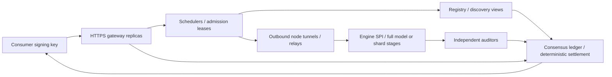

# Ember production architecture

Operators and implementers can use this document to understand the authority,
trust boundaries and remaining design limits. The [threat model](THREAT_MODEL.md),
[engine contract](ENGINE_SPI.md) and [ledger ADR](LEDGER_DECISION.md) describe
security requirements, evidence interfaces and the consensus choice.

## Planes and authority

Control plane: a consensus ledger owns balances, stake, registered model/Profile
hashes, replay protection and final settlement. Registry views derive eligibility
from finalized state plus short-lived signed availability advertisements. Multiple
schedulers propose paths and obtain bounded leases; a node remains the final
resource admission authority. Audit evidence rules follow signed Profiles; assignment and settlement follow
ledger policy. A scheduler or gateway cannot mint Spark, select a weaker
Profile or unilaterally slash. Consensus does not itself prove inference correctness.

Data plane: HTTPS gateways validate consumer authorization, reserve a bounded
charge, relay prompts and stream tokens. Nodes dial outbound authenticated tunnels;
relays need reachable listeners, contributors need no public IP. Engine SPI owns
inference and evidence extraction. A pipeline carries typed hidden states between
stages, not model parameters or raw KV caches. Each stage has its own identity, stake, commitment and receipt, with
deterministic work shares. Group admission reserves every stage atomically or
releases all reservations; see [sharding](SHARDING.md).

Data-plane work is asynchronous to final settlement. A finalized reservation binds
chain/model, manifest, Profile digest, consumer nonce, request/attempt IDs, maximum
cost and expiry height. Receipts bind the reservation and output commitments.
Validators execute integer Spark transitions, never model inference in consensus.
On ambiguous audit or network timeout: retain bounded dispute / refund per policy;
never infer fraud from timing alone. Non-stream retries get a new fenced attempt;
after tokens reach a client, fail visibly rather than silently splice executions.

## Trust domains and keys

| Domain | Keys and verification | Authority / exposed data |
|---|---|---|
| Consumer | Account signing key; scoped expiring gateway token | Authorizes bounded spend; current bearer tokens are centralized |
| Node / stage | Ed25519 identity, node_id = SHA256(public key) | Signs capability, commitment, roots, receipt; sees prompt/hidden states |
| Auditor | Separate identity and stake; registered assignment excludes executor identity | Signed reproducible verdict; sees prompt and opened evidence |
| Validator | Consensus voting key separated from account/operator keys | Orders deterministic transitions under chosen quorum assumptions |
| Gateway / relay | TLS transport key, scoped service authorization | Relays bytes; cannot authorize arbitrary spending or weaker evidence |
| Model publisher | Offline manifest/Profile/genesis signing key | Pins artifacts and rules; signature is provenance, not proof of model quality |

Use domain-separated deterministic protobuf signatures. Additive absent fields
preserve old signed bytes; unknown-field/schema changes require versioned signing
domains and interoperability vectors. TLS keys authenticate transport separately
from ledger/account signatures. Local private keys require mode 0600, private state
0700; rotation/revocation needs finalized registry updates and explicit activation
heights, not silent key replacement. Old genesis is immutable. No production secret
is committed. Registered auditors sign their own verdicts. Shard RPC authenticates signed
scheduler requests and persistent nonces. Legacy SQLite mode retains coordinator
authority and must not be treated as decentralized settlement.

TLS protects links, not prompt privacy from gateways/executors/auditors. No TEE,
MPC or end-to-end privacy claim is made. Prompt retention in the audit spool must
be bounded and disclosed; evidence publication should minimize plaintext access.

## Implementation map and limits

| Component | Responsibility | Remaining boundary |
|---|---|---|
| [Protocol](../proto/ember.proto), [Go core](../core-go/core.go), [Python core](../core-py/ember_core/__init__.py) | Deterministic signatures, chunks and evidence objects | Signatures bind statements, not computational truth |
| [Genesis builders](../chain-genesis/) | Create model/Profile artifacts | Published signed bytes are immutable; new policy requires a new Profile |
| [Node agent](../node/agent/), [engine](../node/engine/) | Outbound authenticated tunnels, admission and inference | HTTP engines cannot satisfy full-evidence Profiles without extensions |
| [Tracker](../services/tracker/), [scheduler](../services/scheduler/) | Discovery cache, path selection and leases | Advertised hardware and common ownership are not remotely attested |
| [Gateway](../services/gateway/) | Consumer authorization, bounded holds, streaming and audit dispatch | Bearer-to-account mapping remains gateway-custodial |
| [Auditor](../node/auditor/), [verifier](../services/verifier/), [queue](../services/auditqueue/) | Replay, evidence verification and durable audit jobs | Reference availability and honest placement remain necessary |
| [Consensus app](../services/chain/), [CLI](../cmd/emberchain/) | CometBFT-ordered integer state transitions | Static genesis validator membership; no proof of independent ownership |
| [Ledger backends](../services/ledger/) | Consensus client or SQLite development accounting | SQLite is a single authority, not a replicated consensus protocol |

Go hosts the protocol services and deterministic settlement application. Python
hosts model runtimes and numerical replay; protobuf/gRPC define their typed
boundary. Engine SPI keeps framework logic independent of a specific inference
engine. No model inference or floating-point comparison runs inside consensus.

Dynamic validator membership, governance, compact state proofs and snapshots/state
sync remain deployment/design work. Consensus finality does not establish model
correctness. Real multi-device and WAN performance require reproducible measurements;
contract tests alone cannot establish either. Numerical audit remains probabilistic
fraud screening with collusion and false-negative risk.

## Token state and KV transfer

The token sequence is the durable execution asset; KV is a derived local cache.
Reconstruction also fixes model/tokenizer hashes, input rendering, positions,
attention rules and execution Profile. Different kernels or numeric formats need
calibrated tolerances rather than an assumption of byte-identical KV.

For a conventional dense attention cache, let L be the number of decoder layers,
H_kv the KV-head count, D the head dimension and s the bytes per cached scalar.
The cache size per token is:

`b = 2 × L × H_kv × D × s` bytes; `KV_bytes(N) = N × b`.

The factor 2 accounts for keys and values; grouped-query attention uses KV heads,
not query heads. Sliding windows, cache quantization and layout overhead change
this estimate. At effective payload bandwidth B bytes/s, transferring the cache
takes approximately `N × b / B`. Rebuilding it at prefill throughput P tokens/s
takes `N / P`. Ignoring fixed costs, transfer wins only when:

`B > b × P` bytes/s, or `BW_bits > 8 × b × P` bits/s.

For illustration, assume b = 144 KiB/token and P = 14,000 tokens/s. The threshold
is about **16.5 Gbit/s**. A 32,768-token cache is 4.83 GB (4.5 GiB); ideal transfer
at 100 Mbit/s takes about 387 seconds, versus an estimated 2.34 seconds to rebuild.
Four-byte token IDs for that prefix occupy 128 KiB, about 1/36,864 of the cache.
These are arithmetic estimates from assumed inputs, not public model/hardware
measurements. Transport overhead, latency, load, model size and actual prefill
throughput must be measured; fast local interconnects can reverse the comparison.

Consequently, a migration design should transfer the prompt and committed token
prefix, reconstruct destination state and fence the new attempt. It need not
move raw KV across the public network. In the current
[Transformers adapter](../node/engine/adapters/transformers.py), generation and
replay already recompute growing prefixes with `use_cache=False`; this is not an
optimized prefill/cache implementation. The source exposes no general raw-KV
import/export or transparent live-session migration interface. Non-streaming
same-range failover exists; after streaming begins a failed attempt terminates
visibly rather than silently splicing a new execution.

Pipeline stages exchange hidden activations while keeping local model state;
they do not pass raw KV between stages. Small activation payloads still incur
serial network latency per generated token. The bandwidth estimate therefore
does not establish WAN pipeline performance or cross-network prefill/decode
separation. See [sharding](SHARDING.md) and [audit replay](AUDIT_DESIGN.md).
